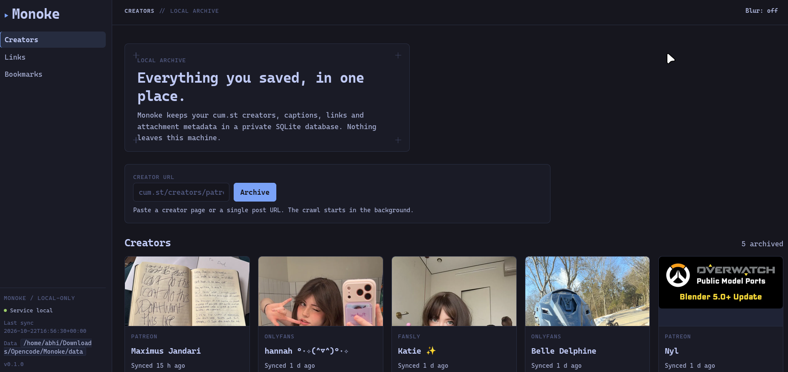
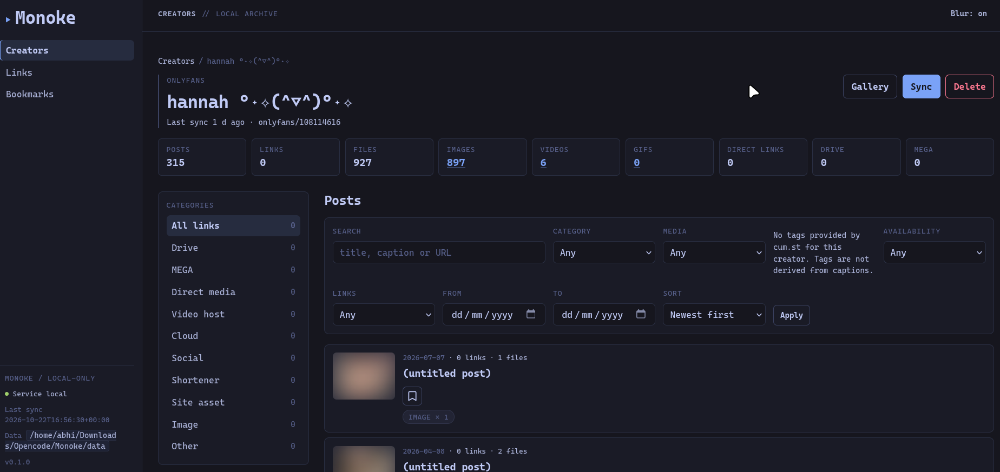
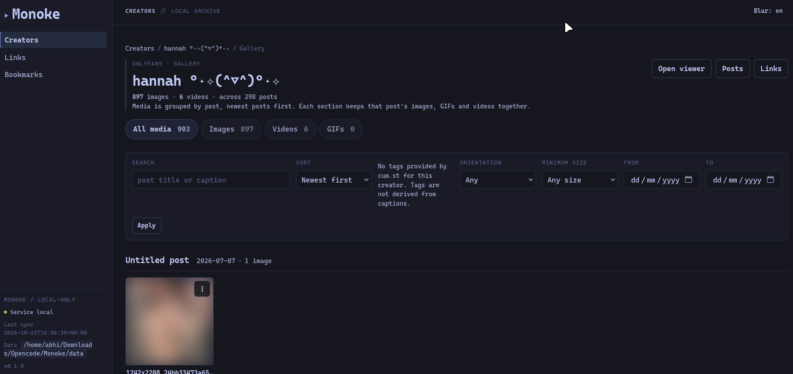
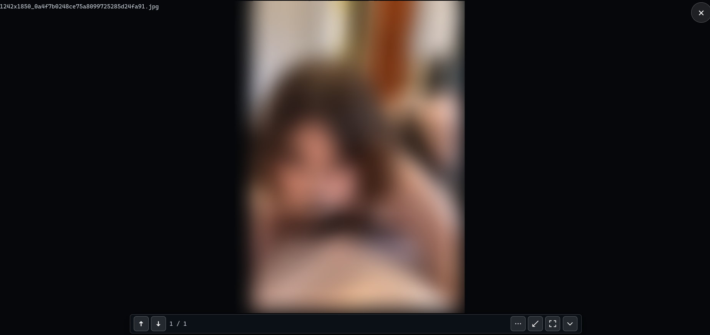
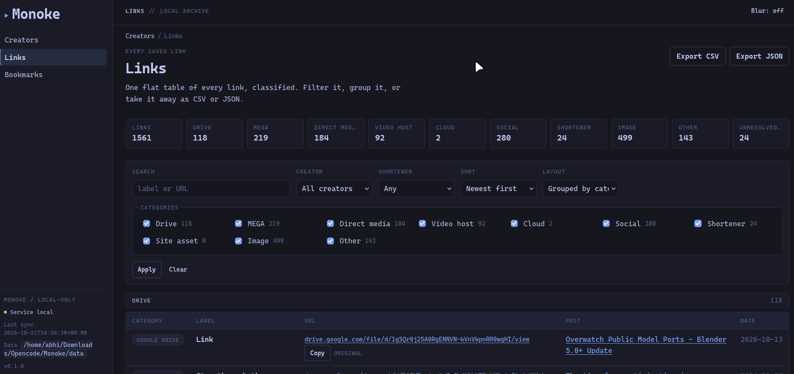
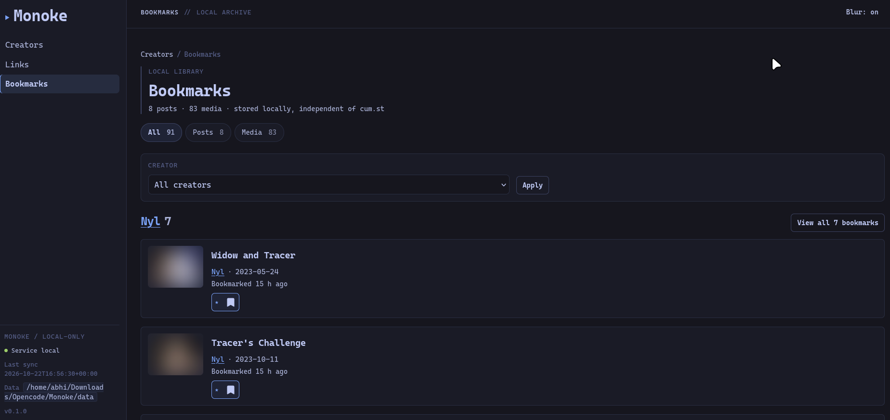
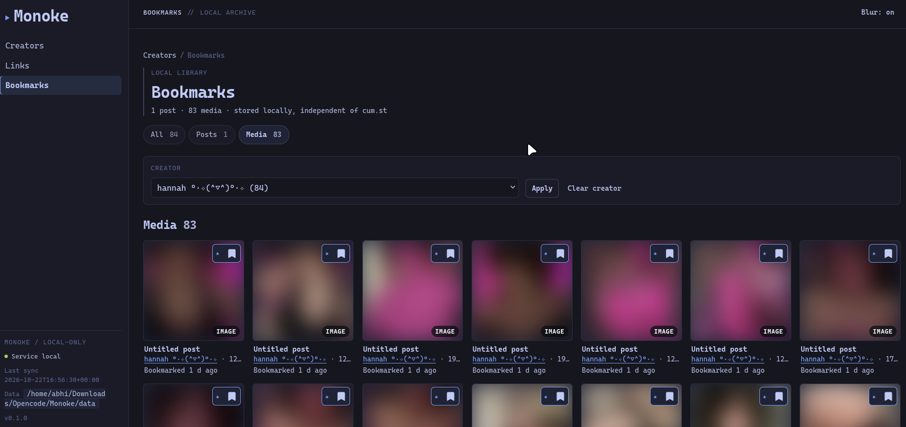

# Monoke

**A local, single-user archive and link index for [cum.st](https://cum.st) creators.**

Paste a creator URL, let Monoke crawl the cum.st API into SQLite, then browse every post,
every caption, every link and every attachment in a clean web app. Re-sync whenever you
want. Nothing leaves your machine.

Monoke never downloads media. Attachments are stored as metadata with a **Load** button
that streams the file into your browser on demand.



## What you get

- **Full archive in one SQLite file** — creators, posts, captions, links, tags,
  attachment metadata and sync history.
- **Every link extracted** — Drive, MEGA, direct media, video hosts, cloud storage,
  social links and shorteners, all classified and filterable. The site's own `links`
  array is unreliable, so Monoke extracts from the caption HTML itself.
- **Post browser** — full-text search, category, media-kind, tag, date, link and
  availability filters. Filters are real URLs, so they can be bookmarked or shared.
- **Per-creator gallery** — posts grouped into sections, each with its images, GIFs and
  videos in viewer order; orientation, size, kind and date filters plus duration sorting
  for timed media. Pagination counts posts.
- **Merged lightbox / viewer** — a gallery tile opens the lightbox in place; expanding
  the same surface turns it into the full-viewport viewer, with browser fullscreen,
  keyboard/wheel/touch navigation across media and posts, media bookmarks and an
  optional first-run hint. No separate viewer page.
- **Bookmarks by creator** — the library groups bookmarks into creator sections with a
  short preview and a **View all** link, while media tiles link back to their post.
- **Local bookmarks** — save posts and individual media items with an icon-only control;
  they survive re-syncs and are independent of cum.st.
- **Link explorer and exports** — browse every link across creators, group or flatten,
  then export the current selection as CSV or JSON.
- **Live sync progress** — page and post counts stream over SSE, with a Cancel button;
  syncs are incremental and safe to re-run.
- **Quiet by design** — binds `127.0.0.1`, no accounts, no telemetry, no media mirroring,
  no external frontend assets and no build step.
- **Purpose-built, dependency-free UI** — dark-only Tokyo Night palette, the self-hosted
  Caskaydia Cove Nerd Font, a fixed sidebar for navigation and archive status, and a
  compact per-page top bar. See [STYLE.md](STYLE.md) for the design rules.

## Screenshots

| Home / Creators | Creator page |
|---|---|
|  |  |

| Gallery | Merged lightbox / viewer |
|---|---|
|  |  |

| Link explorer | Bookmarks |
|---|---|
|  |  |

| Media bookmarks |
|---|
|  |

The interface is dark-only: a Tokyo Night palette with the self-hosted Caskaydia Cove
Nerd Font, a fixed left sidebar for navigation and archive status, and a compact top bar
per page. The gallery and thumbnails are blurred by default; the **Blur** toggle in the
top bar is persisted in `localStorage`.

## Requirements

- **Python 3.14** (see `.python-version`)
- **[uv](https://docs.astral.sh/uv/)** — recommended package and runner manager

Monoke is a local app. It talks only to `cum.st`, its API, its image CDN and (optionally)
shortener hosts, and it writes only to its data directory.

## Install

```bash
git clone https://github.com/infinite-elixir/Monoke.git monoke
cd monoke

uv sync
```

`uv` reads `.python-version` and provisions Python 3.14 if needed. To install runtime
dependencies only:

```bash
uv sync --no-dev
```

## Run

```bash
uv run monoke serve
```

Open **<http://127.0.0.1:8765>**. The health endpoint is at
<http://127.0.0.1:8765/healthz>.

Useful server options:

```bash
uv run monoke serve --port 9000       # different port
uv run monoke serve --host 127.0.0.1  # bind address (default)
uv run monoke serve --reload          # auto-reload while developing
uv run monoke serve --debug           # verbose logs + client debug panel
```

Then paste a creator URL into the form:

```text
https://cum.st/creators/patreon/274608
```

Or archive from the terminal:

```bash
uv run monoke sync https://cum.st/creators/patreon/274608
```

The first crawl fetches the creator profile, walks every list page and fetches each post
detail. For the reference 782-post creator that is roughly 800 API calls and 4–6 minutes
at the default concurrency of 4. Later syncs only fetch new posts and are much faster.

For a complete walkthrough — every page, filter, keyboard shortcut, CLI flag, environment
variable and troubleshooting step — see
**[docs/INSTALL_AND_USAGE.md](docs/INSTALL_AND_USAGE.md)**.

## CLI at a glance

```bash
uv run monoke --help
uv run monoke serve [--host HOST] [--port PORT] [--reload] [--debug]
uv run monoke sync URL [--full|--deep] [--limit N] [--concurrency N]
                       [--no-cache] [--no-resolve] [--json]
uv run monoke db stats
uv run monoke db reclassify [--dry-run]
```

| Command | What it does |
|---|---|
| `monoke serve` | Runs the web app on `127.0.0.1:8765`. |
| `monoke sync URL` | Crawls one creator. Incremental unless `--full`/`--deep`. |
| `monoke sync URL --full` | Re-fetches every post detail, even unchanged ones. |
| `monoke sync URL --no-resolve` | Skips third-party shortener resolution (faster, offline-ish). |
| `monoke db stats` | Prints table row counts and database size. |
| `monoke db reclassify` | Recomputes normalized attachment kinds from stored raw fields; no network. |

`sync` exits `0` on success, `2` on bad arguments/URL, `3` when cum.st blocks the crawl,
`130` when cancelled and `1` on other failures.

## Where data lives

Everything is under `./data/` by default:

```text
data/
  monoke.db          # SQLite database (WAL mode)
  monoke.debug.log   # only when debug mode is on
```

Override the directory with `MONOKE_DATA_DIR`:

```bash
MONOKE_DATA_DIR=/srv/monoke uv run monoke serve
```

The database is the archive. Back it up by copying `data/monoke.db` (and its `-wal` /
`-shm` files) while the server is stopped. Deleting a creator inside the app removes its
posts, links, files and tags; manual media is never involved because Monoke never stores
media.

## Configuration

The most useful environment variables:

| Variable | Default | Purpose |
|---|---|---|
| `MONOKE_DATA_DIR` | `./data` | Database and log location. |
| `MONOKE_HOST` | `127.0.0.1` | Bind address. Do not expose this app publicly. |
| `MONOKE_PORT` | `8765` | HTTP port. |
| `MONOKE_DEBUG` | `0` | Same as `--debug`. |
| `MONOKE_CONCURRENCY` | `4` | Parallel post-detail requests. |
| `MONOKE_RESOLVE` | `1` | Resolve shortener redirects on sync. |
| `MONOKE_CACHE_TTL` | `60` | API response cache lifetime in seconds. |

The complete list (`MONOKE_API_BASE`, `MONOKE_TIMEOUT`, `MONOKE_PAGE_SIZE`,
shortener budget/timeouts and more) is documented in
[docs/INSTALL_AND_USAGE.md](docs/INSTALL_AND_USAGE.md#configuration).

## Debug mode and diagnostics

```bash
uv run monoke serve --debug          # writes data/monoke.debug.log
MONOKE_DEBUG=1 uv run monoke serve   # same, via env var
```

In debug mode the server logs every request (method, path, status, duration) to
`data/monoke.debug.log` (rotated at 2 MB, three backups) and marks pages with
`data-debug="1"`, which enables the collapsible client-side debug panel automatically.
The panel records console errors, uncaught errors, promise rejections and failed htmx
requests, capped at 400 lines.

Diagnose a single page without restarting:

```text
http://127.0.0.1:8765/?debug=1    # force the debug panel for this page
http://127.0.0.1:8765/?quiet=1    # no debug capture, no timers, no DOM writes
```

Memory stays bounded: debug log 2 MB × 4 files, client panel 400 lines, crawl event
history 200 events × 16 runs, and `api_cache` entries older than 7 days are pruned after
a crawl.

## How it works

```text
Browser ──► FastAPI @ 127.0.0.1:8765
              ├─ Jinja2 templates + vendored htmx, SSE for sync progress
              ├─ asyncio crawler (4 concurrent, jitter + backoff)
              ├─ caption extractor and link classifier
              └─ SQLite: creators, posts, files, links, tags, runs,
                         api_cache, link_resolutions, bookmarks
cum.st API ◄── /api/v1/...   (plain JSON, no auth)
```

- Monoke uses the cum.st JSON API only — no headless browser, no DOM scraping.
- Requests are paced to stay under the site's rate limit; `429`/`Retry-After` is honored
  with a global cooldown, and the crawler stops after repeated blocks.
- Posts that disappear upstream are flagged `missing_upstream` and never deleted.
- Raw post JSON is retained so extraction can be rerun without re-fetching.
- Attachments are normalized from mime type, filename, variants and duration; the
  upstream value is kept in `files.raw_kind`.

See [PLAN.md](PLAN.md) for the design decisions and [tickets/](tickets/) for the backlog.

## Development

```bash
uv run pytest                 # offline test suite
MONOKE_LIVE=1 uv run pytest -m live
```

The app must run with **one uvicorn worker**. The sync progress bus and active-run
registry are in-process; extra workers would split SSE clients from the crawl publishing
events.

## Status

The crawler, extractor, post browser, link explorer, gallery, fullscreen viewer, live sync
progress, incremental sync, bookmarks and debug mode are implemented. Remaining polish and
acceptance work is tracked in the epic tickets.

## Notes and limitations

- Local and private by design: no auth, no accounts, no telemetry. Keep it bound to
  `127.0.0.1`.
- Media is hot-linked from cum.st edge hosts and only loaded when you ask for it. If an
  edge host is slow or blocks hot-linking, use **Open** to view the file directly.
- The cum.st API is unofficial and may change. Failures are surfaced with the response
  body rather than silently swallowed.
- Link health is not probed automatically; shortener targets are resolved, but Monoke
  does not monitor link rot.
- Adult content: thumbnails are blurred by default and the app ships no external assets.
